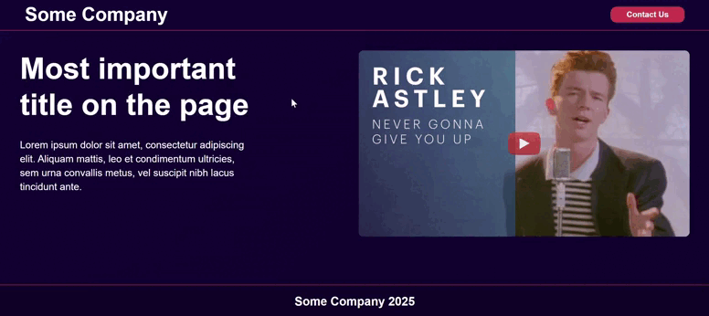
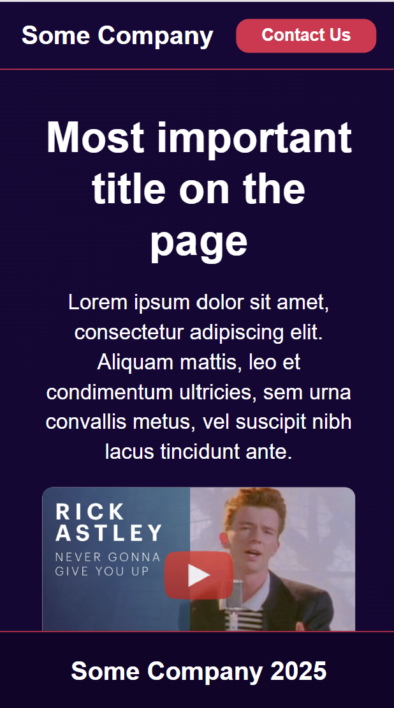
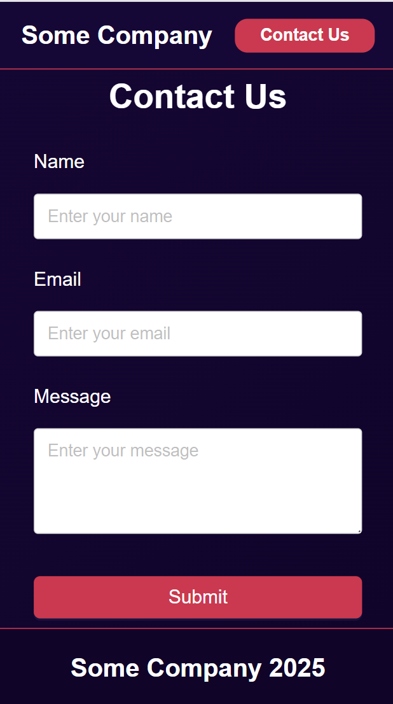
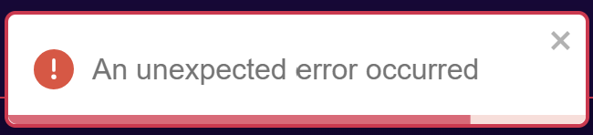
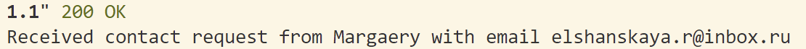

# Двухстраничный веб-сайт
https://margaery.tishenko.dev/



## Технологии

### Фронтенд
- `React` + `TypeScript`
- `Vite` (инструмент сборки)
- `Ant Design` (UI компоненты)
- `Styled Components` (CSS-in-JS)
- `React Hook Form` (управление формами)
- `react-lite-youtube-embed` (оптимизированное встраивание видео)
- `Axios` (API клиент)

### Бэкенд
- `Python` + `FastAPI`

## Инструкции по настройке

### Фронтенд
(необходим `Node.js`)
```bash
# Установка зависимостей
npm install

# Запуск сервера разработки
npm run dev

```

### Бэкенд
```bash
# Создание и активация виртуальной среды
python -m venv venv
source venv/bin/activate  # В Windows: venv\Scripts\activate

# Установка зависимостей
pip install -r requirements.txt

# Запуск сервера
uvicorn main:app --reload
```

## Особенности

### Отзывчивый дизайн с мобильной версткой  



### Подход к стилизации
- Использованы Styled Components для стилей, специфичных для компонентов
- Реализована последовательная цветовая схема
- Созданы многоразовые стилизованные компоненты для общих элементов UI
- Добавлены состояния наведения и фокуса для лучшего взаимодействия с пользователем
- Липкий заголовок и нижний колонтитул на обеих страницах  
- Использованы современные CSS-функции, такие как flexbox и CSS Grid для отзывчивых макетов

### Реализация форм
- Создано с помощью `React Hook Form` для эффективного управления формами
- Добавлена валидация на стороне клиента
- Реализованы состояния ошибок и сообщения  


- Добавлены состояния загрузки во время отправки

### Оптимизация видео YouTube
   Используется `react-lite-youtube-embed`, видео загружается только когда пользователь взаимодействует, что улучшает начальную загрузку страницы

### Доступность

- Семантическая структура HTML
- Проверка форм с ясными сообщениями об ошибках

### Интеграция с бэкендом
- Простой бэкенд на Python для обработки отправок форм
- Логи данных формы в консоли

- Возвращает персонализированное сообщение об ответе

### Развертывание:
- Создайте файл `.env`, аналогичный `.env.example`.
- Чтобы развернуть приложение, используйте `docker compose up`.
- API доступен по адресу `http://{your_url}/api`.

## Автор

Чурина Маргарита

# Two-Page Website
https://margaery.tishenko.dev/  


## Tech Stack

### Frontend
- `React` + `TypeScript`
- `Vite` (build tool)
- `Ant Design` (UI components)
- `Styled Components` (CSS-in-JS)
- `React Hook Form` (form management)
- `react-lite-youtube-embed` (optimized video embedding)
- `Axios` (API client)

### Backend
- `Python` + `FastAPI`

## Setup Instructions

### Frontend
(`Node.js` required)
```bash
# Install dependencies
npm install

# Run development server
npm run dev

```

### Backend
```bash
# Create and activate virtual environment
python -m venv venv
source venv/bin/activate  # On Windows: venv\Scripts\activate

# Install dependencies
pip install -r requirements.txt

# Run server
uvicorn main:app --reload
```

## Features

### Responsive design with mobile layout  


### Styling Approach
- Used Styled Components for component-specific styling
- Implemented a consistent color scheme
- Created reusable styled components for common UI elements
- Added hover and focus states for better user interaction
- Sticky header and footer on both pages  
- Used modern CSS features like flexbox and CSS Grid for responsive layouts

### Form Implementation
- Built with `React Hook Form` for efficient form handling
- Added client-side validation
- Implemented error states and messages  


- Added loading states during submission

### YouTube Video Optimization
   Used `react-lite-youtube-embed`, video loads only when user interacts, improving initial page load

### Accessibility Features

- Semantic HTML structure
- Form validation with clear error messages

### Backend Integration
- Simple Python backend to handle form submissions
- Logs form data to console

- Returns personalized response message

### Deployment:
- Create a `.env` file similar to `.env.example`.
- To deploy the application, use `docker compose up`.
- The API is available at `http://{your_url}/api`.

## Author

Churina Margarita
